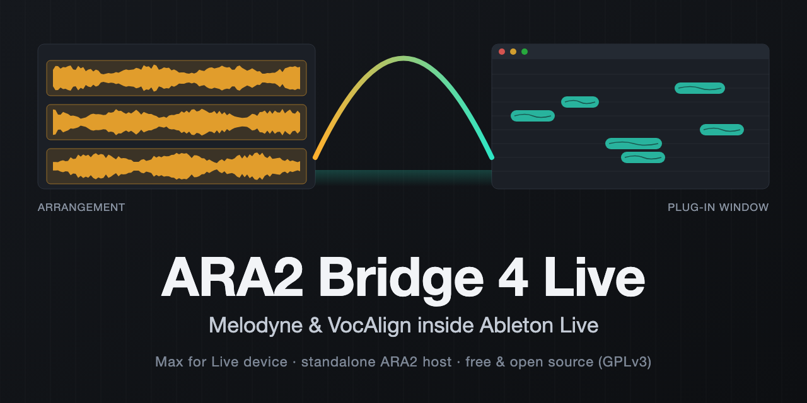

<p align="center">
  <a href="https://www.instagram.com/enableton"></a>
  <a href="https://x.com/its_enableton"></a>
  <a href="https://github.com/Enableton/ara2-bridge-4-live/releases/latest"></a>
</p>

# ARA2 Bridge 4 Live

Use **Melodyne** and **VocAlign** (ARA2 plug-ins) with **Ableton Live**, which has no ARA2 support of its own.

A Max for Live device sends the selected audio clip from Live's **Arrangement View** to a small separate macOS app
(**BridgeHost**) that hosts the plug-in as an ARA2 host. You edit in the plug-in's own window with playback. When you
press **Apply**, the host renders the result offline and the device puts it back into the Arrangement as a take lane, a
new track, or in place of the original clip.

> **Status: experimental, v0.2.** Verified by the author with Live 12.4.6, Melodyne 5 and VocAlign 6 Pro on Apple
> Silicon. Other versions and machines are untested. Read "Known limits" before you rely on it.

## What it does

| | |
|---|---|
| **Melodyne** | Send a clip, edit in Melodyne's window, **Apply to Live**. The edited audio comes back, with Melodyne's slight post-edit timing shift corrected automatically. |
| **Preview** (Melodyne, optional toggle) | While Melodyne is open, every edit shows up a fraction of a second later as a clip on a **Preview** track under the source track (two tracks, A and B, take turns so there is no gap). Live plays it, so you hear the edit in sync with the rest of the project; the original clip is muted meanwhile. Apply or Cancel removes the Preview tracks and unmutes the original. |
| **VocAlign** | Pick a **guide** clip and a **dub** clip, align in VocAlign's window, **Apply to Live**. The result starts exactly at the guide's start, which is what you want for backing vocals against a lead. |
| **Placement** | Take lane (original untouched), new track, or replace in place (original kept on a muted backup track). All undoable with Cmd+Z. |

The result is a normal audio file in your Live project (`results/` folder, picked up by Collect All and Save).

## Requirements

| | |
|---|---|
| Mac | **Apple Silicon** (arm64). Intel is not supported. The host is built for macOS 12 or newer, tested on the newest macOS. |
| Ableton Live | **Live 12 with Max for Live** (Suite, or Standard plus the Max for Live add-on). |
| Plug-ins | **Your own licensed copies** of Melodyne 5 (an edition with ARA support) and/or VocAlign 6 Pro, installed as **VST3**. |

This repository contains no Melodyne or VocAlign code, and nothing in it bypasses their licensing. See "Licensing".

## Install: build it yourself (no Apple Developer account needed)

You build BridgeHost on your own Mac. This needs only the free tools below, not a paid Apple Developer Program
membership: a program you compile yourself is not quarantined by macOS, and Apple Silicon only requires the *ad-hoc*
signature that the linker adds automatically. No notarization, no certificate.

### 1. Tools

- **Xcode** (free; Mac App Store or developer.apple.com/download) opened once so that it finishes installing its
  components, and selected as the active toolchain: `sudo xcode-select -s /Applications/Xcode.app`.
  The full Xcode is needed, the Command Line Tools alone are not enough (the SDK is built with `xcodebuild`).
- **CMake** and **git**: `brew install cmake git` (or any other way).
- **Python 3** (comes with the Command Line Tools or Homebrew) and, optionally, **Node.js** (only for the device's
  build checks and tests; Live brings its own Node for the device itself).

### 2. Get the source and the SDKs

```bash
git clone https://github.com/Enableton/ara2-bridge-4-live.git
cd ara2-bridge-4-live
tools/setup_sdk.sh
```

`setup_sdk.sh` downloads Celemony's ARA SDK and Steinberg's VST3 SDK at the exact versions this project is pinned to
into `third_party/` and applies the project's small patch. It needs internet access and a few hundred MB.

### 3. Build and install the host

```bash
tools/build_host.sh        # builds BridgeHost (a few minutes the first time)
tools/install_host.sh      # copies it to ~/Library/Application Support/ARABridge/bin/BridgeHost
~/"Library/Application Support/ARABridge/bin/BridgeHost" --find-plugins
```

The last command should print `"found": true` for each plug-in you have installed (VST3 files in
`/Library/Audio/Plug-Ins/VST3` or the same folder in your home). If a plug-in lives somewhere else, see "Troubleshooting".

### 4. Build the Max for Live device

```bash
python3 device/make_amxd.py
```

This writes `device/ARABridge.amxd`. The device refers to its scripts by **absolute path inside this checkout**
(`device/build/bridge.js` and `device/src/runner.js`), so keep the folder where it is, and re-run the command if you move
it or after pulling new changes. The path must not contain spaces.

### 5. Use it in Live

Drag `device/ARABridge.amxd` from Finder onto the **audio track that holds the clip**. After a few seconds the device
says `Ready.` plus the plug-ins it found. Full instructions, the status messages and troubleshooting are in
[device/README.md](device/README.md).

## Using it

- Works on **Arrangement** audio clips on a track's main lane. **Warp must be off**; no looping, no transposition, track
  not frozen. If a clip does not qualify, the device tells you why and changes nothing.
- **Melodyne:** select the clip, **Send to Melodyne**, edit, **Apply to Live** in the host window (Space plays; choose your
  audio interface in the window's Output menu if you hear nothing).
- **VocAlign:** put the device on the guide track *and* on the dub track (Live shows only the selected track's devices).
  Select the guide clip and press **Set guide (VocAlign)**; select the dub clip and press **Send to VocAlign**; align; **Apply**.
- **Preview** (Melodyne; "Live preview"): on for a new device. After each edit the Preview tracks (A and B, in turns) play the new
  version from below the source track; the original clip is muted automatically and unmuted when you apply or cancel.
- **Sync transport** (Melodyne): on for a new device (a set you saved earlier keeps its own switch). Then Play, Stop and the playhead in Live move Melodyne's
  cursor, and Play, Space or a click in Melodyne's time ruler start, stop or move Live. Melodyne's own playback is silent: you hear
  Live. Combine it with **Preview** to hear the edit in Live. Constant tempo only.
- **Skip timing fix** (Melodyne; "Skip timing correction"): leave it off normally. Switch it on if you ever hear clicks that are not in the
  host window.

## Sharing a build with a friend

`tools/make_package.sh` builds `build/package/ARA2-Bridge-4-Live.zip`: the host (built for macOS 12+), the device pointing
at `/Users/Shared/ARABridge/device`, an `install.sh`, the source, the licenses and READMEs in German and English
(`dist/`). The recipient needs no developer tools. The binary is not notarized, so only share it with people you trust;
`install.sh` removes the download quarantine mark for them.

## Licensing

**ARA2 Bridge 4 Live is free software under the GNU General Public License v3** (see [LICENSE](LICENSE)), copyright
(C) 2026 Enableton.

- BridgeHost links the **Steinberg VST3 SDK**, which is dual-licensed (Steinberg proprietary or GPLv3). This project uses
  the GPLv3 option, which is why the whole project is GPLv3. If you redistribute binaries, you must also provide the
  corresponding source and keep the license notices.
- It also builds on **Celemony's ARA SDK** (Apache 2.0) with bundled zlib, BSD and MIT parts. Details, versions and the
  full texts: [THIRD_PARTY_NOTICES.md](THIRD_PARTY_NOTICES.md) and [docs/licenses/](docs/licenses/).
- **Melodyne and VocAlign are not part of this project.** No code, data or assets from them are included, nothing is
  modified, and nothing circumvents their licensing or copy protection. You need your own valid licenses, and you are
  responsible for using the plug-ins according to their license agreements.
- **No warranty.** The device edits your Live set. Back up your projects.
- *Ableton, Live, Max and Max for Live* are trademarks of Ableton AG / Cycling '74. *Melodyne* and *ARA* are
  trademarks of Celemony Software GmbH. *VocAlign* is a trademark of Synchro Arts Ltd. This project is independent and
  is not affiliated with, endorsed or supported by any of them.

## Known limits

- One job at a time per device; a second Send is refused with a status message.
- WAV/AIFF sources give exact timing; MP3/M4A sources can come back offset by a few milliseconds.
- If clip, track or tempo change while the plug-in window is open, the result is not placed (the project stays unchanged).
- Live's API cannot delete take lanes, so a rolled-back take-lane placement leaves an empty lane.
- Clips shorter than about 0.8 s are not corrected for Melodyne's timing shift.
- Only Apple Silicon, only VST3 plug-ins, only Arrangement clips. Not tested with VocAlign versions other than 6 Pro.
- More in [device/README.md](device/README.md) and [docs/superpowers/specs/2026-10-22-ara-bridge-design.md](docs/superpowers/specs/2026-10-22-ara-bridge-design.md) (section 8.1).

## Troubleshooting

- **A plug-in shows `found: false`:** it must be a VST3 bundle named like `Melodyne.vst3` or `VocAlign6Pro.vst3` in
  `/Library/Audio/Plug-Ins/VST3` or `~/Library/Audio/Plug-Ins/VST3`. For anything else, create
  `~/Library/Application Support/ARABridge/settings.json` with
  `{"pluginPaths": {"melodyne": "/path/Melodyne.vst3", "vocalign": "/path/VocAlign.vst3"}}` and press **Refresh plug-ins**.
  With several versions installed, the highest version is used.
- **`xcodebuild` or `cmake` not found / wrong developer directory:** see step 1; check `xcode-select -p`.
- **The device says `BridgeHost is not installed`:** run `tools/install_host.sh`, then **Refresh plug-ins** in the device.
- **No sound in the host window:** choose your interface in the window's **Output** menu.
- **Logs:** `~/Library/Application Support/ARABridge/device.log` and `jobs/<newest>/host.log` + `result.json`.

## Repository layout

| Path | What |
|---|---|
| `host/` | BridgeHost (C++/Objective-C++): job files, ARA hosting, offline render, glitch repair, timing realignment, UI. Unit tests in `host/tests/`. |
| `device/` | The Max for Live device: `src/` (JavaScript), `make_amxd.py` (generates the `.amxd`), `tests/`. |
| `tools/` | Setup, build, install, packaging and analysis scripts. |
| `dist/` | Files for the friend package (install/uninstall scripts, German and English READMEs). |
| `docs/superpowers/specs/` | Design and the host/device contract. |
| `docs/superpowers/plans/` | The implementation plans the project was built from. |
| `docs/licenses/` | License texts of the third-party components. |

## Development

```bash
tools/build_tests.sh                       # host unit tests (CMake only, no SDK needed)
node device/tests/test_core.js             # device logic
node device/tests/test_bridge.js           # device against a fake Live (needs a built host for the end-to-end case; --skip-real otherwise)
node device/tests/test_runner.js
python3 -I device/tests/test_amxd_container.py
```

Some tests use real Melodyne/VocAlign installs or recordings of the author and report `skipped` when those are missing.
`tools/check_edit.py` and `tools/measure_alignment.py` (need numpy) check a finished job's result.

Issues and pull requests are welcome. Please include the status line text and the logs mentioned above.
